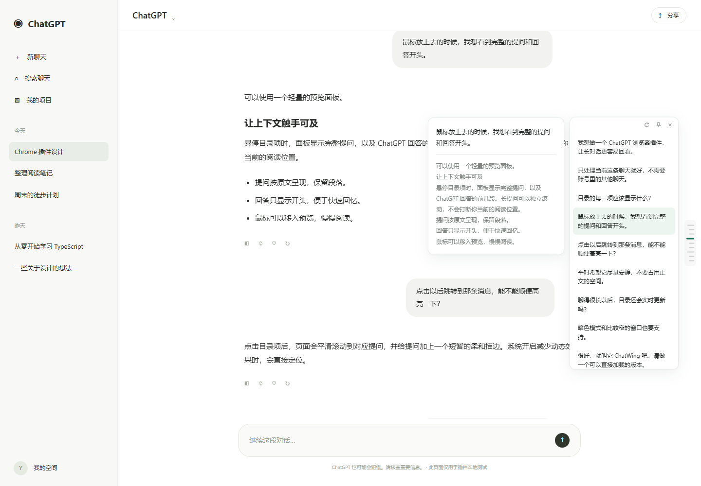

# ChatWing · ChatGPT 对话目录

为当前 ChatGPT 聊天添加一个可收起的提问目录。悬停预览上下文，点击回到任意一轮，让长对话更容易回看。

无需 API Key，无需构建，安装后即可使用。

*本地测试页面演示，使用模拟对话。*

## 功能

- **提问目录**：在页面右侧悬停展开，每次提问对应一个目录项。
- **对话计数**：左上角显示「已读 N 轮」，补全后保留已读历史，长目录支持滚轮浏览首尾。
- **上下文预览**：悬停目录项，查看完整提问和回答开头。
- **快速定位**：点击跳转并短暂高亮，也支持键盘导航。
- **按需固定**：点击图钉固定目录，方便连续回看。
- **自动更新**：跟随新消息、回答生成、提问编辑和聊天切换更新，适配明暗主题。
- **补全长对话**：通过滚动读取网页延迟渲染的消息，并恢复阅读位置。

## 安装

### 使用发布包

1. 打开 [最新版本](https://github.com/strive-yang/ChatWing/releases/latest)，下载 `ChatWing-<版本>.zip`。
2. 将 ZIP 解压到一个准备长期保留的文件夹。
3. 在 Chrome 地址栏输入 `chrome://extensions`，打开右上角的「开发者模式」。
4. 点击「加载已解压的扩展程序」，选择解压后**包含 `manifest.json` 的文件夹**。
5. 打开 [ChatGPT](https://chatgpt.com)，刷新已经打开的聊天页。

Chrome 不能直接加载 ZIP；安装后请保留解压目录。发布包位于 Release 的附件中，与 GitHub 自动生成的 `Source code` 源码包分开。

### 从源码安装

也可以克隆本仓库，或通过 **Code → Download ZIP** 下载并解压源码，然后按上面第 3–5 步加载仓库根目录。运行扩展无需安装 Node.js、Python 或 npm 依赖。

## 使用

| 操作 | 效果 |
| --- | --- |
| 悬停页面右侧细栏 | 展开目录，移开鼠标后自动收起 |
| 悬停目录项 | 预览完整提问和回答开头 |
| 点击目录项 | 跳转到该轮提问并短暂高亮 |
| 点击图钉 | 固定或取消固定目录 |
| 点击圆形箭头 | 补全长对话目录；再次点击可停止 |
| 按 Esc 或点击关闭按钮 | 收起目录 |

键盘操作、长对话补全和常见问题见[使用指南](docs/usage.md)。

## 更新与卸载

下载新版后，用新版文件替换已加载目录的内容。在 `chrome://extensions` 点击 ChatWing 卡片上的刷新按钮，再刷新 ChatGPT 聊天页，两步都需要。源码安装可先更新本地源码，再执行相同操作。

卸载时，在 `chrome://extensions` 中移除 ChatWing。

## 隐私与使用范围

- 只在 `https://chatgpt.com/*` 和旧域名 `https://chat.openai.com/*` 上运行。
- 对话仅在当前页面的内存中处理，不上传、不持久保存；不读取登录令牌，不调用 ChatGPT 私有 API。
- 使用 Manifest V3 内容脚本，不申请 cookies、tabs、storage 等额外权限。
- 只整理当前聊天分支中网页提供的文字，不检索其他聊天；图片、文件和语音等内容不做识别。
- 长对话受网页加载机制限制，补全功能不能保证读到站点尚未提供的消息。
- ChatGPT 页面改版可能影响识别；当前兼容性验证使用本地模拟页面，真实站点仍可能存在差异。

ChatWing 是独立项目，与 OpenAI 无隶属关系。

## 项目文档

- [使用指南与常见问题](docs/usage.md)
- [更新记录](CHANGELOG.md)
- [开发与测试](docs/development.md)
- [参与贡献](CONTRIBUTING.md)

## 许可证

采用 [MIT License](LICENSE)。
